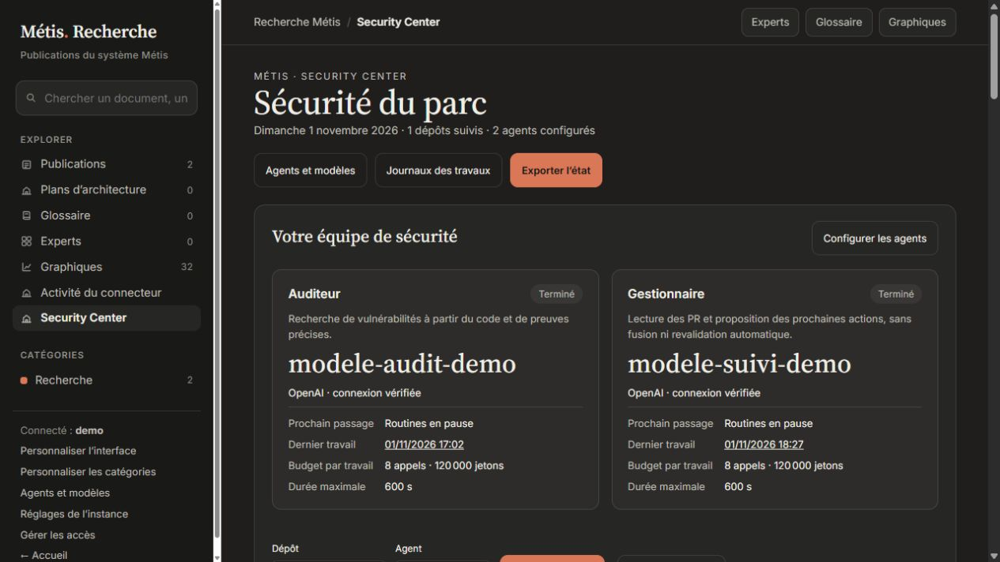

# Métis Server

**Your research workspace and security audit routines, on a machine you control.**

[Français](README.fr.md) · [Configuration](docs/configuration.md) · [Security model](SECURITY.md)

Métis Server combines versioned research documents, persistent work items, an
authenticated MCP connector, and a Security Center that can run scheduled static
code reviews through your own AI provider. It runs independently of Atlas and
does not require a Plagnito account or a specific Raspberry Pi.

**Initial public preview.** The interface is currently in French. Provider
adapters are covered by simulated API contract tests; verify access to your chosen
model using the connection test before enabling an audit routine.

The Security Center now requires initial agent setup: separate auditor and manager
names, providers, models, credentials, instructions, schedules and budgets. Access
to GitHub and enabled models must be verified before completion; routine activation
is an explicit choice. Existing automatic routines are paused during migration.
Jobs record the model actually used. The manager provides advisory PR/finding
follow-up using its assigned model, without confirming findings or merging PRs.

**Personnaliser l’interface** customizes the sidebar name, subtitle, labels, order,
visibility and counters. See [Security Center configuration](docs/security-center.md).

## Install

With Docker and Docker Compose installed:

```sh
git clone https://github.com/Plagnito/metis-server.git
cd metis-server
docker compose up -d --build
docker compose logs metis
```

Open **http://localhost:4880**, enter the installation code shown in the logs,
and create your administrator. No configuration file or API key is required to
start. The code is single-use and is never exposed by the public API.

Then open **Configuration**, select your modules and repositories, configure an
AI provider, save, and test the connections. Under **Routines**, create a daily
routine, choose its budget and enable it. All routines start disabled.

Docker publishes the port on **127.0.0.1**. A named volume stores your database,
encrypted credentials and instance key across updates. The container runs as an
unprivileged user, with a read-only root filesystem and no Docker socket.

Without Docker, install **Node.js 24 or newer** and run:

```sh
npm ci --omit=dev --ignore-scripts
npm start
```

The original Métis interface is rendered on the server using Express; no frontend
build is needed. On Windows, `Start-Metis.cmd` installs the pinned dependencies
on first launch and starts the server in a terminal. The machine must remain on for
scheduled routines to run.

Publications, glossary, experts, SVG charts and Security Center reuse the original
Métis renderers. Open **Personaliser les catégories** in the sidebar to rename
publication categories and the three Security Center groups. Renaming preserves
document membership and history; the default labels and layout match the original.

## What you can do

- Write Markdown documents, preserve every version, and reject stale edits.
- Keep work items and append immutable research notes through MCP.
- Connect MCP clients with OAuth authorization code + PKCE, or limited Bearer keys.
- Select specific GitHub repositories, including private repositories you authorize.
- Use a fine-grained GitHub token or your instance's GitHub App in read-only mode.
- Configure OpenAI Responses, Anthropic Messages, or a compatible local endpoint.
- Run daily static audits and pull-request follow-up without an open chat.
- Inspect the pinned commit, source reads, candidate findings, usage and job log.
- Cancel jobs, resume interrupted work within its remaining budget, and revoke access.

AI adapters require a model that supports their tool-calling contract. Compatibility
is checked by a small test call. Configuring an MCP client and configuring API
access for autonomous routines are separate operations.

## Deliberate boundaries of this preview

Audits **read source code; they do not execute it**. No shell, dependency installation,
repository tests, automatic code changes, pull-request creation or merging is
available to the audit agent. An isolated execution runner is a later extension.

A finding is a candidate supported by a previously read, exact source excerpt.
Severity and exploitability remain declarations to review. A merged correction
and a revalidation are distinct states. An empty report is not a security guarantee.

The research module implements documents, versions, work items and notes. This
preview does not bundle the full Atlas scientific registry, agent handoff system,
personal research corpus or Metis Lab installation. There is no automatic import
of your Atlas database.



One administrator owns an instance. Integration identities have separate read/write
scopes. This is not a hosted service with independent customer tenants.

## Routines and budgets

Each routine targets one repository at a daily local time. The server persists its
queue and runs one job at a time. Daily occurrence keys prevent repeated runs in
the duplicated hour at the end of daylight saving time. A missing spring time is
caught up at the next valid local time; a missed occurrence earlier today is caught
up when the server returns. Previous days are not replayed in bulk.

Limits cover calls, total tokens, response tokens, source reads, source bytes and
wall time. Before each API request, the server reserves a conservative token bound
based on UTF-8 request bytes plus the output allowance. It settles to provider
usage when reported. An ambiguous failed call retains its reservation and is not
automatically retried. These are **usage limits, not a guaranteed currency cap**.

Interrupted jobs remain visible after a restart and can be resumed manually within
their existing budget. Exhausted jobs require an explicit new launch. Model and
provider changes require a new job to preserve provenance.

## Remote access and MCP

Keep the default local binding, and put an HTTPS reverse proxy or tunnel in front
of it when remote access is needed. Configure the public HTTPS origin in the web
interface. For example, a Caddy site on the same host:

```caddy
metis.example.com {
    reverse_proxy 127.0.0.1:4880
}
```

The MCP URL is `https://metis.example.com/mcp`. OAuth metadata is available under
`/.well-known/oauth-protected-resource` and `/.well-known/oauth-authorization-server`.
Authorization endpoints use the configured origin; forwarded headers are not
trusted. A cloud-hosted MCP client cannot reach your machine's localhost address.

The **Connecteurs** page lists integration keys and OAuth clients, with revocation.
Scopes are `metis:read`, `metis:write`, `security:read`, and `security:write`.
Write scope does not implicitly grant read scope; request both when needed.
OAuth access tokens expire in one hour; refresh tokens are not supported in this
preview. Clients must authorize again when needed.

## Updates and backups

Back up before updating, then:

```sh
git pull --ff-only
docker compose up -d --build
```

See [backup and restore](docs/backup.md). A backup includes the encrypted secret
database **and its instance key**. Treat the complete backup as private. Restore
into a new data directory; existing data is never overwritten. Restoration checks
the complete file manifest and invalidates prior sessions and integration keys.

## Development and validation

```sh
npm test
npm run check:release
```

Tests use disposable databases and mock GitHub/model responses, with HTTP and MCP
round trips against loopback servers. They cover installation, roles, OAuth PKCE,
revocation, source policy, evidence matching, budgets, interruption, DST, secrets
and backup restoration. No test uses a real provider key or sends a real repository
to an AI service.

CI runs on Windows and Linux with Node 24/26 and includes a Docker Compose startup
check. See [validation status](docs/validation.md) for what was actually run for the
initial preview. Intended image targets are amd64 and arm64; no Pi performance
claim is made until tested on that hardware.

## License

GNU AGPL v3 only. See [LICENSE](LICENSE) and [NOTICE](NOTICE).

Created by Plagnito. The Security Center domain logic is extracted from Atlas,
with a fresh public repository history and no personal database or credentials.
